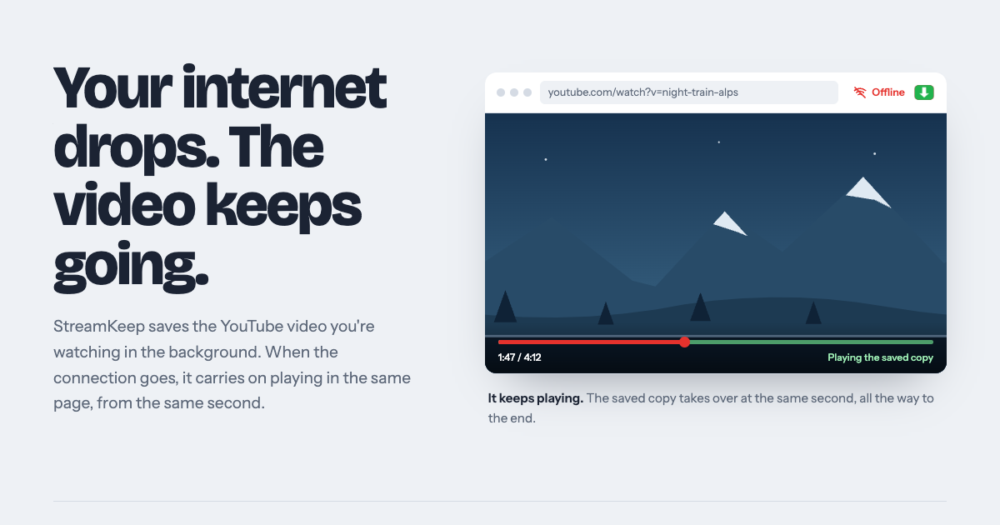

<p align="center"></p>

<h1 align="center">StreamKeep: offline playback for YouTube</h1>

<p align="center">
Your internet drops. The video keeps going, on the same page.<br>
A free, open-source extension for <b>Safari</b>, <b>Chrome</b> and <b>Firefox</b>.<br>
<a href="https://davidmusijenko.github.io/streamkeep/">Website</a> ·
<a href="https://github.com/DavidMusijenko/streamkeep/releases/latest">Download</a> ·
<a href="#install">Install</a>
</p>

---

Open a YouTube video and StreamKeep saves it in the background. If your
connection drops (a train tunnel, flaky café Wi-Fi, a router reboot), the saved
copy takes over **inside the same YouTube page, from the same second**. There's
no download button and no file to manage. When you're back online, click "Back
to YouTube".

<p align="center"></p>

## Features

- **Switches automatically** when the connection is really gone: the browser goes
  offline, YouTube shows its error screen, or playback stalls and a
  connectivity check fails. A slow moment alone doesn't trigger it.
- **Sharp picture:** up to 4K, in VP9 or AV1 when your browser can play them,
  H.264 otherwise.
- **Toolbar icon** shows the save progress (`42%`) and turns green when the whole
  video is saved.
- **Popup** with the current video (play saved copy, save, cancel, re-save,
  delete), settings (quality, format, auto-save, auto-switch, skip long videos,
  how long to keep videos, cache size limit), and the list of saved videos.
- **Cleans up after itself:** videos unwatched for 7 days are deleted, and the
  cache is capped at 30 GB (oldest first). Both are adjustable.
- **Player controls** on the saved copy: seek, volume, fullscreen, and the
  usual keys (space/k, j/l, ←/→, m, f).
- **Private:** no accounts, servers or analytics. The extension only talks to the
  helper on your own computer.

## How it works

StreamKeep has two parts:

| Part | What it does |
| --- | --- |
| `helper/streamkeep_helper.py` | A small local service on `http://127.0.0.1:8765` (Python standard library only). It saves each video with [yt-dlp](https://github.com/yt-dlp/yt-dlp), remuxes it with ffmpeg into fragmented MP4, and serves it in fragments. Saved videos go to `~/Movies/StreamKeep` (macOS) or `~/Videos/StreamKeep` (Linux). |
| `extension/` | The browser extension. The content script asks the helper to save each video you open, watches for the connection dropping, and then plays the saved copy through a `MediaSource` in the page. The background script relays requests to the helper, because a YouTube page can't load `http://127.0.0.1` directly. |

## Install

### 1. The helper (once)

Needs Python 3, yt-dlp and ffmpeg. Works on macOS and Linux.

```bash
brew install yt-dlp ffmpeg        # Linux: use your package manager
git clone https://github.com/DavidMusijenko/streamkeep
cd streamkeep
./helper/install.sh
```

On macOS it runs as a LaunchAgent, and on Linux as a systemd user service. Either way it
starts at login and restarts if it stops. Remove it with
`./helper/install.sh --uninstall`. Your saved videos are left in place.

### 2. The extension

**Chrome** (and Edge, Brave, Arc and other Chromium browsers)

1. Download `streamkeep-chrome-*.zip` from the
   [latest release](https://github.com/DavidMusijenko/streamkeep/releases/latest)
   and unzip it, or run `python3 build.py chrome` and use `dist/chrome`.
2. Open `chrome://extensions` and turn on **Developer mode**.
3. Click **Load unpacked** and choose the folder.

**Firefox** (128 or newer)

1. Download `streamkeep-firefox-*.zip` from the
   [latest release](https://github.com/DavidMusijenko/streamkeep/releases/latest),
   or run `python3 build.py firefox`.
2. Open `about:debugging`, choose **This Firefox**, click **Load Temporary
   Add-on**, and pick the zip (or `dist/firefox/manifest.json`).
3. Temporary add-ons are removed when Firefox quits. To keep it installed, use
   Firefox Developer Edition or Nightly with `xpinstall.signatures.required` set
   to `false`, and install the zip from `about:addons`.

If the popup asks for access, click **Allow access**. Firefox grants site
access separately.

**Safari** (macOS, needs Xcode)

```bash
TEAM=<your Apple team id> ./install-app.sh
```

This builds the app, installs it to `/Applications/StreamKeep.app` and opens it.
A free Apple ID works for local builds. Find your team ID in Xcode under
Settings, then Accounts. Then, in Safari, open **Settings**, then
**Extensions**, and tick **StreamKeep**. On youtube.com, choose **Always Allow
on This Website**.

## Building

```bash
python3 build.py            # dist/chrome, dist/firefox, dist/safari + zips
python3 build.py chrome     # one browser only
```

`extension/manifest.json` is the shared base. `build.py` adjusts it for each
browser: Firefox gets an event page and a gecko id, and Chrome and Firefox drop
the Safari-only native messaging permission. The Safari Xcode project lives in
`safari/StreamKeep/`, and `SafariWebExtensionHandler.swift` is a native fallback
relay to the helper.

## FAQ

**Is this a video downloader?** Not in the usual sense. There's no "save as"
and no files to share. It keeps a temporary copy of what you're already
watching, so playback doesn't stop, and deletes it after a while.

**Is it allowed?** YouTube's Terms of Service don't allow saving videos
outside YouTube's own features, so using StreamKeep is your own responsibility.
[YouTube Premium](https://www.youtube.com/premium) offers official offline
playback in YouTube's apps.

**Why isn't it in the Chrome Web Store or App Store?** Both stores reject tools
that save YouTube videos, so StreamKeep is shared as source and release builds.

**Which audio does it save?** AAC where the browser plays it, otherwise Opus
(for example in Chromium builds without AAC).

## License

[MIT](LICENSE). StreamKeep is an independent project. It is not affiliated
with, endorsed by, or sponsored by YouTube or Google. YouTube is a trademark of
Google LLC.
